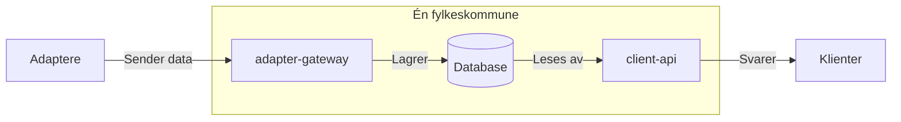

## Hvorfor Core 2

Core 2, vår oppdaterte API-integrasjonsplattform, bygger videre på det beste fra sin forgjenger og introduserer en rekke forbedringer som gagner både brukere og andre interessenter. Selv om denne oppgraderingen medfører at adaptere må oppdateres og tilpasses, er fordelene så åpenbare at vi mener endringen er nødvendig.

### Årsaker til nyutvikling

- **Ustabilitet med SSE:** Bruken av Server Sent Events har vist seg å være ustabil, noe som fører til at både vi og brukerne tidvis må restarte adapterne.
- **Ineffektiv dataoppdatering:** Det er uhensiktsmessig å hente fullstendige datasett hvert 15. minutt, ettersom oppdateringsbehovet varierer.
- **Samkjøring av alle fylkeskommuner i samme container:** Selv om data er trygt avskilt, er det mer hensiktsmessig å dele opp fylkeskommunene for å oppnå bedre isolasjon og skalerbarhet.
- **Full datahenting ved restart:** Ved en restart må all data hentes på nytt, noe som kan føre til unødvendig belastning og nedetid.

### Fordeler med den nye arkitekturen

- **Forbedret horisontal skalering:** Hver organisasjon kjører nå i separate tjenester, noe som sikrer et stabilt driftsmiljø og isolerer eventuelle problemer til den berørte organisasjonen.
- **Overgang til REST API:** Skiftet fra SSE til REST API gir økt stabilitet og trygghet ved å benytte en mer utbredt teknologisk plattform.
- **Økt fleksibilitet i dataoverføring:** Adapter-leverandører kan oppdatere data etter behov, med mulighet til å sende deltaendringer og slette data, i stedet for å overføre komplette datasett med jevne mellomrom.
- **Egen database for hver organisasjon:** Dataene ligger i en database, ikke i minnet til tjenestene. Når client-api starter på nytt, er dataene tilgjengelige med en gang, og adapterne trenger ikke sende alt på nytt.
- **Full bakoverkompatibilitet:** Eksisterende løsninger som benytter konsumer-API-et, trenger ikke endres, med noen få unntak (se [Core 2](integrate/consume/core2.md)). Dette sikrer kontinuitet og stabilitet for alle integrasjoner.
- **Autorelasjon:** En innebygd funksjon som automatisk oppretter og vedlikeholder relasjoner, slik at adapteret slipper å bygge og vedlikeholde relasjoner selv.

### Slik er Core 2 bygget

Hver fylkeskommune får sin egen client-api, sin egen adapter-gateway og sin egen database.

- Adapterne sender data til adapter-gatewayen, som lagrer dem i databasen. Se [Adapter API](integrate/provide/core2-adapter-api.md).
- client-api henter dataene fra databasen og svarer klientene.
- Oppdateringer fra klienter går motsatt vei: client-api lagrer dem som hendelser i databasen, og adapterne henter dem fra adapter-gatewayen.
- Har en ressurstype ikke hatt en fullstendig synkronisering på 21 dager, slettes dataene for den. Se [Fullstendig synkronisering](integrate/provide/core2-adapter-api.md?id=fullstendig-synkronisering).
