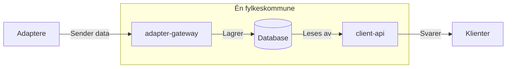

## Hvorfor Core 2

Core 2, vår oppdaterte API-integrasjonsplattform, bygger videre på det beste fra sin forgjenger og introduserer en rekke forbedringer som gagner både brukere og andre interessenter. Selv om denne oppgraderingen medfører at adaptere må oppdateres og tilpasses, er fordelene så åpenbare at vi mener endringen er nødvendig.

### Årsaker til nyutvikling

- **Ustabilitet med SSE:** Bruken av Server Sent Events har vist seg å være ustabil, noe som fører til at både vi og brukerne tidvis må restarte adapterne.
- **Ineffektiv dataoppdatering:** Det er uhensiktsmessig å hente fullstendige datasett hvert 15. minutt, ettersom oppdateringsbehovet varierer.
- **Samkjøring av alle fylkeskommuner i samme container:** Selv om data er trygt avskilt, er det mer hensiktsmessig å dele opp fylkeskommunene for å oppnå bedre isolasjon og skalerbarhet.
- **Full datahenting ved restart:** Ved en restart må all data hentes på nytt, noe som kan føre til unødvendig belastning og nedetid.

### Fordeler med den nye arkitekturen

- **Forbedret horisontal skalering:** Hver organisasjon kjører nå i separate tjenester, noe som sikrer et stabilt driftsmiljø og isolerer eventuelle problemer til den berørte organisasjonen.
- **Overgang til REST API:** Skiftet fra SSE til REST API gir økt stabilitet og trygghet ved å benytte en mer utbredt teknologisk plattform.
- **Egen database for hver organisasjon:** Dataene ligger i en database, ikke i minnet til tjenestene. Når client-api starter på nytt, er dataene tilgjengelige med en gang, og adapterne trenger ikke sende alt på nytt.
- **Full bakoverkompatibilitet:** Eksisterende løsninger som benytter konsumer-API-et, trenger ikke endres, med noen få unntak (se [Core 2](integrate/consume/core2.md)). Dette sikrer kontinuitet og stabilitet for alle integrasjoner.

### Fordeler for fylkeskommunen og klientene

#### Tilgangsstyring for ressurser, felt og relasjoner

I Core 1 gjelder tilgangen til en klient hele komponenten. I Core 2 kan fylkeskommunen også fjerne tilgangen til deler av en komponent:

- **Ressurs:** Klienten får ikke hente ressursen. Prøver den, svarer FINT med `403 Forbidden`.
- **Felt:** Feltet er ikke med i svaret.
- **Relasjon:** Relasjonen er ikke med i `_links` i svaret.

Slik kan fylkeskommunen gi hver klient bare de dataene den trenger. Tilgangen settes for hver klient i Kundeportalen, se [Klienter](portal/klient.md). Den gjelder data som leveres fra Core 2, se [Hva ligger hvor](integrate/consume/platforms.md).

#### Data er tilgjengelige med en gang etter en omstart

I Core 1 ligger dataene i minnet til tjenesten. Starter tjenesten på nytt, eller krasjer den, må klientene vente 15–30 minutter mens cachen bygges opp igjen.

I Core 2 ligger dataene i en database. Tjenesten starter på noen sekunder, og alle dataene er tilgjengelige fra første forespørsel.

### Fordeler for adapterleverandører

#### Fullstendig synkronisering i flere sider

I Core 1 må adapteret sende alle ressursene av en type i ett svar når FINT ber om alle dataene. I Core 2 kan adapteret dele en fullstendig synkronisering opp i sider, og sende hver side som en egen forespørsel. Det gjør store datamengder enklere å overføre. Se [Paginering av dataene](integrate/provide/core2-adapter-api.md?id=paginering-av-dataene).

#### Oppdateringer etter behov

Adapteret kan oppdatere data etter behov. Det kan sende deltaendringer og slette data, i stedet for å overføre komplette datasett med jevne mellomrom. Se [Adapter API](integrate/provide/core2-adapter-api.md).

#### Autorelasjon: relasjoner bare én vei

Med autorelasjon trenger adapteret bare å sende en relasjon fra den ene siden. FINT bygger den andre siden av relasjonen. Det gjør det enklere å bygge opp ressursene, fordi adapteret ikke må samle relasjonene fra begge sider.

Autorelasjon gjelder ikke alle relasjoner. Se [Autorelasjon](integrate/provide/core2-autorelation.md) for hvilke relasjoner som støttes, og hvordan funksjonen virker.

### Slik er Core 2 bygget

Hver fylkeskommune får sin egen client-api, sin egen adapter-gateway og sin egen database.

- Adapterne sender data til adapter-gatewayen, som lagrer dem i databasen. Se [Adapter API](integrate/provide/core2-adapter-api.md).
- client-api henter dataene fra databasen og svarer klientene.
- Oppdateringer fra klienter går motsatt vei: client-api lagrer dem som hendelser i databasen, og adapterne henter dem fra adapter-gatewayen.
- Har en ressurstype ikke hatt en fullstendig synkronisering på 21 dager, slettes dataene for den. Se [Fullstendig synkronisering](integrate/provide/core2-adapter-api.md?id=fullstendig-synkronisering).
